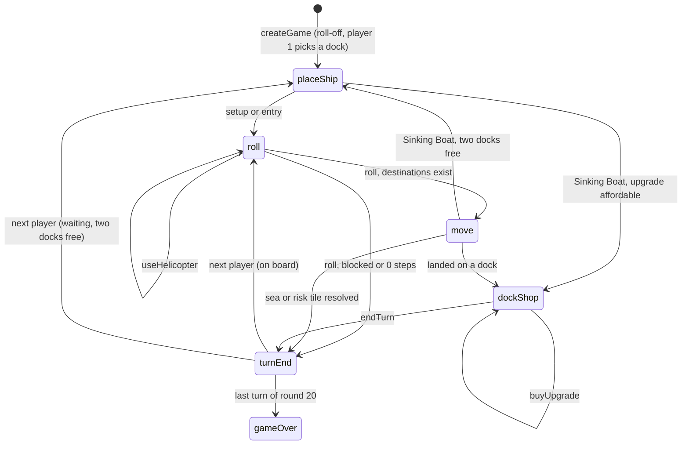

# Architecture

Written in Session 1, stage 1b (2026-11-11). The types are in `packages/engine/src/types.ts`; this file explains them. Rule decisions are logged in `docs/rulebook-engine-notes.md`; the full list is in [section 12](#12-rule-ambiguities).

## 1. Decisions

The defaults in `docs/build-plan.md` §2 are confirmed (monorepo layout, pure engine, JSON state, authoritative server, room code and seat token) with these changes:

1. **Content is an argument, not part of the state.** Every engine function takes `content`; the state stores only `contentHash`. This keeps the state small on the wire and lets replays detect mismatched content.
2. **`createGame(content, setup)` returns `{ state, events }`.** The turn-order roll-off runs inside it on the seeded RNG, so there is no interactive roll-off phase.
3. **`applyAction` returns a result union and never throws for an illegal action.** The server maps `{ ok: false, error }` straight to a rejection message.
4. **Legality depends only on public information.** `getLegalActions` accepts the full state or a client view, so bots and the web client run the same function on what they can see.
5. **Phases follow "who must decide".** Tile and card resolution is automatic inside the `move` action. A phase exists only where a player rolls or has a real choice.
6. **Every phase lists `actors: PlayerId[]`.** No rule currently needs several players to choose at once, but the array keeps the protocol ready for one.
7. **Redaction strips the RNG state as well as deck order.** Otherwise a client could predict dice and shuffles.
8. **Every action carries its `player`, and the state carries `actionCount`.** A replay is content + setup + actions; the server uses `actionCount` as its sequence number.
9. **The board is authored as character grids and compiled to an indexed `Board`.** Grids are easy to trace and check by eye in Session 2a.
10. **Ship placement is an action (`placeShip`)** shared by setup, late entry and Sinking Boat.

## 2. Packages

| Package           | Depends on | Rule                                                                                                       |
| ----------------- | ---------- | ---------------------------------------------------------------------------------------------------------- |
| `packages/engine` | nothing    | Pure and deterministic. No I/O, `Math.random`, `Date`, `process` or `console`. Does not read files itself. |
| `packages/server` | engine     | Loads `content/*.json`, owns rooms and the authoritative `GameState`, validates intents with the engine.   |
| `packages/sim`    | engine     | Bots and batch games. Bots choose from `getLegalActions` on a `PlayerView`.                                |
| `apps/web`        | engine     | Renders a `PlayerView` and the event log. Calls `getLegalActions` locally to highlight tiles and buttons.  |

The caller loads the three content files and passes them to `compileContent`. The engine never imports JSON.

## 3. Engine contract

Declared as the `Engine` interface in `types.ts`:

```ts
compileContent(raw: RawContent): ContentResult
createGame(content: Content, setup: GameSetup): GameUpdate
getActors(state: AnyState): PlayerId[]
getLegalActions(content: Content, state: AnyState, player: PlayerId): Action[]
applyAction(content: Content, state: GameState, action: Action): ApplyResult
redactForClient(state: GameState, viewer: Viewer): PlayerView
replay(content: Content, log: ReplayLog): GameUpdate
```

- `applyAction` treats its input as immutable and returns a new state. It applies the action and then runs every automatic step up to the next decision, so one action can produce many events (move, draw, catch, end of turn, end of round, event draw, next turn start).
- `getLegalActions` returns complete actions. Callers never build an action by hand; they pick one from the list. The largest list is move destinations (a few dozen at most).
- `applyAction` accepts an action if and only if it is in `getLegalActions` for that player.

## 4. State, phases and turn flow

`GameState` and `PlayerView` share `PublicState<TDeck>`:

| Field                    | Meaning                                                                                   |
| ------------------------ | ----------------------------------------------------------------------------------------- |
| `schemaVersion`          | `1`. Bump on any breaking change to the state shape.                                      |
| `contentHash`            | Hash of the content the game was created with.                                            |
| `actionCount`            | Actions applied so far.                                                                   |
| `players`                | In turn order. Cash, fish (a list of token values), fine tokens, upgrades, position.      |
| `round`, `turn`          | Round 1–20; `turn.playerIndex` and `turn.helicopterUsed`.                                 |
| `phase`                  | The pending decision (below).                                                             |
| `decks`                  | `safe`, `risk`, `event`. Full state: `{ draw, discard }`. View: `{ drawCount, discard }`. |
| `activeEvent`            | The event card in force, or `null` before round 5 ends.                                   |
| `goldenFish`             | The Golden Fish token on the board, if any.                                               |
| `result`                 | Scores and winners once the game is over.                                                 |
| `rng` (`GameState` only) | sfc32 state.                                                                              |

A player's `position` is `null` while they wait off the board. The bank is unlimited and not modelled.

### Phases

| Phase       | Actor decides                   | Legal actions                   | Entered when                                                                   |
| ----------- | ------------------------------- | ------------------------------- | ------------------------------------------------------------------------------ |
| `placeShip` | Which free dock                 | `placeShip`                     | Setup (player 1), late entry, Sinking Boat; only if two or more docks are free |
| `roll`      | Roll, or Helicopter first       | `roll`, `useHelicopter`         | Start of every turn for a ship on the board                                    |
| `move`      | Destination                     | `move` (one per reachable tile) | The roll gives at least one legal destination                                  |
| `dockShop`  | Buy upgrades                    | `buyUpgrade`, `endTurn`         | Docked, or relocated by Sinking Boat, and an unowned upgrade is affordable     |
| `turnEnd`   | Helicopter before the turn ends | `useHelicopter`, `endTurn`      | The Helicopter is usable (below)                                               |
| `gameOver`  | Nothing                         | none                            | After the last turn of the last round                                          |

**Automatic steps.** The engine resolves, without a phase, anything with no real choice: placing a ship when one dock is free, skipping a waiting player when none is, a blocked or zero-step move, tile and card resolution, paying fine tokens and selling fish on docking, skipping the shop when nothing is affordable, ending the turn, ending the round, drawing an event. `roll` is always explicit so each player triggers their own dice.

**Helicopter.** A lasting event. While it is active, the current player may use it once per turn (`turn.helicopterUsed`), either before rolling or at the end of the turn after the tile or card has resolved. It is usable when the player has at least one fish and cash of at least the fee. Using it pays the fee from cash, then pays fine tokens from the sale, then banks the rest.



`turnEnd` in the diagram is a point every turn passes through; it only becomes a phase a player sees when the Helicopter is usable. Between the last turn of a round and the next `roll`, the engine ends the round and, after rounds 5, 10 and 15, expires the old event and draws the next.

### Movement (for Session 3)

Reachable destinations are found by a search over `(tile, previous tile)` for exactly `roll.steps` steps on `board.neighbours`, with these filters:

- no step back onto the tile just left;
- no step onto a tile holding another ship (so no passing through and no ending there);
- a dock may only be the final step, and never directly from another dock;
- the final tile is not the start tile and is not an occupied dock.

`MoveAction` names only the destination. The `moved` event carries one legal path, chosen deterministically, for animation.

## 5. Actions

`placeShip { dock }`, `roll`, `move { to }`, `buyUpgrade { upgrade }`, `useHelicopter`, `endTurn`. All carry `player`. The server sets `player` from the connection's seat, never from the client's message.

Errors: `game-over`, `unknown-player`, `not-your-turn`, `wrong-phase`, `illegal-action`.

## 6. Events

`GameEvent` is the public log of what an action caused, in order. Events carry enough data to animate and narrate without diffing states (the roll breakdown, the path, the card drawn, fish kept and lost, money paid). All events are public: there are no private hands in this game. "Event" alone means a `GameEvent`; the yellow deck is always "event card" (`EventCardDef`, `activeEvent`).

## 7. Content schemas

Three files in `content/`, typed as `BoardContent`, `CardsContent` and `RulesConfig`.

### `board.json` (written in Session 2a)

```json
{
  "width": 5,
  "height": 4,
  "terrain": ["~~~~D", "~#SS~", "~~~~~", ".D.D."],
  "zones": ["3333-", "2---2", "11111", "-----"],
  "docks": [
    { "id": "cruise", "kind": "cruise", "x": 4, "y": 0 },
    { "id": "start-left", "kind": "starting", "x": 1, "y": 3 },
    { "id": "start-right", "kind": "starting", "x": 3, "y": 3 }
  ],
  "fishingSpots": [{ "spot": 1, "x": 0, "y": 2 }],
  "zoneNames": { "1": "Pearl Shallows", "2": "Kelp Reach", "3": "Windward Deep" }
}
```

Terrain characters: `.` off-board, `~` sea, `#` island, `D` dock, `S` Shipwreck Bay, `J` Davy Jones' Locker. Zone characters: `1`, `2`, `3`, or `-` for any tile that is not open sea. A fishing spot is an overlay: the tile keeps its terrain and zone, and draws a card as normal when no Golden Fish is on it. `compileContent` checks grid sizes, that every sea tile has a zone and no other tile does, that every `D` has exactly one dock entry, and that spots sit on sea or risk tiles.

### `cards.json` (Session 2b converts `card-counts.json`)

```json
{
  "cards": {
    "boot": {
      "id": "boot",
      "name": "Boot",
      "effect": { "kind": "fish", "count": 0, "value": 100 }
    },
    "fish+3": {
      "id": "fish+3",
      "name": "Circus fish",
      "effect": { "kind": "fish", "count": 3, "value": 100 }
    },
    "fish-700": {
      "id": "fish-700",
      "name": "Red Dragon",
      "effect": { "kind": "fish", "count": 1, "value": 700 }
    },
    "fine-200": {
      "id": "fine-200",
      "name": "Sadder Dolphin",
      "effect": { "kind": "fine", "amount": 200 }
    },
    "shark": { "id": "shark", "name": "Shark", "effect": { "kind": "shark", "count": 3 } },
    "sinking-boat": {
      "id": "sinking-boat",
      "name": "Sinking Boat",
      "effect": { "kind": "sinkingBoat" }
    },
    "golden-fish-1": {
      "id": "golden-fish-1",
      "name": "Golden Fish – Spot 1",
      "effect": { "kind": "goldenFish", "spot": 1, "value": 1000 }
    },
    "catch-bonus-1": {
      "id": "catch-bonus-1",
      "name": "+1 Fish to All Catch – Zone 1",
      "effect": { "kind": "catchBonus", "zone": 1, "count": 1, "value": 100 }
    },
    "movement+1": {
      "id": "movement+1",
      "name": "+1 Movement",
      "effect": { "kind": "movement", "delta": 1 }
    },
    "helicopter": {
      "id": "helicopter",
      "name": "Helicopter",
      "effect": { "kind": "helicopter", "fee": 200 }
    },
    "shark-repellent": {
      "id": "shark-repellent",
      "name": "Shark Repellent",
      "effect": { "kind": "sharkRepellent", "area": "shipwreck-bay" }
    },
    "tsunami": {
      "id": "tsunami",
      "name": "Tsunami",
      "effect": { "kind": "reshuffleDiscard", "deck": "risk" }
    }
  },
  "decks": {
    "safe": { "boot": 4, "fish+1": 4, "fish+2": 4, "fish+3": 4, "fine-100": 2 },
    "risk": {
      "boot": 2,
      "fish+3": 2,
      "fine-200": 2,
      "fish-300": 3,
      "fish-500": 2,
      "fish-700": 1,
      "shark": 3,
      "sinking-boat": 1
    },
    "event": {
      "golden-fish-1": 1,
      "catch-bonus-1": 1,
      "movement+1": 1,
      "helicopter": 1,
      "shark-repellent": 1,
      "tsunami": 1
    }
  }
}
```

(The example lists a subset of cards; the real file has all of them.) The `safe` and `risk` objects of `card-counts.json` become `decks.safe` and `decks.risk` unchanged, and its card ids are kept. `upgradePrice` moves to `rules.json`. Every number a balancer may want to change (fish values, fine amounts, shark bite, bonus size, Helicopter fee, Golden Fish value) is in the card's effect.

### `rules.json`

```json
{
  "minPlayers": 2,
  "maxPlayers": 4,
  "rounds": 20,
  "eventAfterRounds": [5, 10, 15],
  "dieSides": 6,
  "startingCash": 0,
  "baseCapacity": 5,
  "fineTokenValue": 100,
  "upgrades": {
    "speed": { "price": 200, "rollBonus": 2 },
    "capacity": { "price": 200, "capacity": 8 }
  }
}
```

## 8. RNG, determinism and replays

- **Generator:** sfc32. Its state is four unsigned 32-bit integers (`RngState`), it uses only 32-bit integer maths (identical in every JS runtime), and it passes the standard statistical test suites.
- **Seeding:** the setup's seed string is hashed to four words with cyrb128, then the generator is advanced a few rounds.
- **Integers:** uniform in a range by rejection sampling, so there is no modulo bias on the die.
- **Shuffle:** Fisher–Yates.
- **One stream** for the roll-off, dice and shuffles. Every draw returns the next RNG state, which goes back into `state.rng`.
- **Replay:** `ReplayLog` holds `contentHash`, `setup` and the ordered `actions`. `replay` re-creates the game and applies each action; the result must match the original state exactly. The server appends to the log as it applies actions.

No engine output depends on object key order, wall-clock time or the host.

## 9. Hidden information

| Information                                                      | Visibility |
| ---------------------------------------------------------------- | ---------- |
| Order of every draw pile, including the undrawn event cards      | Hidden     |
| RNG state                                                        | Hidden     |
| Size of each draw pile, every discard pile                       | Public     |
| Each player's cash, fish values, fine tokens, upgrades, position | Public     |
| Active event, Golden Fish, round, phase, roll                    | Public     |

`redactForClient(state, viewer)` replaces each deck with `{ drawCount, discard }` and drops `rng`. Every viewer currently receives the same information; the `viewer` parameter is there so a future private element does not change the signature. A drawn card is revealed by its `cardDrawn` event and resolves inside the same action, so there is never a drawn-but-hidden card in the state.

## 10. Protocol sketch (designed fully in Session 5)

| Direction       | Message                                    | Notes                                                                    |
| --------------- | ------------------------------------------ | ------------------------------------------------------------------------ |
| client → server | `join { roomCode, name, seatToken? }`      | A seat token reclaims a seat after a disconnect.                         |
| server → client | `welcome { seat, seatToken, room, view? }` | `view` is present if the game has started.                               |
| client → server | `intent { clientActionId, action }`        | The server sets `action.player` from the seat.                           |
| server → all    | `update { actionCount, events, view }`     | Sent after every accepted action. The whole view each time; it is small. |
| server → client | `rejected { clientActionId, error }`       | Only to the sender.                                                      |

- `actionCount` orders updates. A client that sees a gap asks for, or is sent, the latest view; no event history is needed to recover.
- Legality is the only guard against stale intents: an intent that is no longer legal is rejected.
- Reconnect: present the seat token, receive the current view.
- Disconnect or timeout: the server may submit an action on the player's behalf, chosen from `getLegalActions` (for example `roll`, the first legal `move`, `endTurn`). The policy belongs to Session 5; the engine needs nothing extra for it.

## 11. Invariants (for the fuzz test in stage 4c)

- Cash is never negative.
- `fish.length` never exceeds the ship's capacity.
- No two ships share a tile.
- A player holding fine tokens has $0 cash.
- Each deck's draw pile plus discard pile always holds the full deck list.
- `applyAction` accepts exactly the actions in `getLegalActions`.
- `getLegalActions` gives the same result on a state and on its redacted view.
- Every game reaches `gameOver` after the last round, and `replay` reproduces the final state.

## 12. Rule ambiguities

All items were decided by the designer on 2026-11-11 and are logged in `docs/rulebook-engine-notes.md`. `docs/rulebook.md` has been updated to match.

| #   | Question                           | Answer                                                                                                                                                               | Status  |
| --- | ---------------------------------- | -------------------------------------------------------------------------------------------------------------------------------------------------------------------- | ------- |
| 1   | Zone of risk-area tiles            | Risk tiles have no zone. "+1 Fish to All Catch" never applies to Risk draws.                                                                                         | Decided |
| 2   | No-step-back rule                  | Per step: no immediate reversal. A path may loop back over tiles visited earlier in the same move. Only the end tile may not be the start tile.                      | Decided |
| 3   | Passing over docks                 | A dock can only be the last step of a move. No passing through any dock, free or taken.                                                                              | Decided |
| 4   | Leaving a dock                     | The dock is the start tile. If every legal move is blocked, the ship stays, misses the turn and does not dock again.                                                 | Decided |
| 5   | Roll modifiers                     | Steps = max(0, die + Speed + movement event). All bonuses are mandatory. Zero steps ends the turn with no card.                                                      | Decided |
| 6   | Helicopter timing                  | A lasting event, active until the next event or the end of the game. Once per own turn, at the start or at the end, a player may pay $200 and sell all their fish.   | Decided |
| 7   | Event expiry                       | Helicopter is not instant (see 6). Tsunami is instant but still replaces the previous event. An unclaimed Golden Fish is removed at the next event draw or game end. | Decided |
| 8   | Golden Fish and capacity           | It counts as one fish. See 22 for a full ship.                                                                                                                       | Decided |
| 9   | Shark                              | Shark Repellent protects Shipwreck Bay only. No tie-break is needed: equal-value tokens are identical.                                                               | Decided |
| 10  | Capacity overflow                  | New fish beyond capacity are lost; no swapping. A single big fish drawn on a full ship is lost.                                                                      | Decided |
| 11  | Fines                              | Cash first, then $100 tokens for the rest, with no cap. On docking, tokens are paid from the sale before anything is bought.                                         | Decided |
| 12  | Sinking Boat                       | Lose all fish and move to a starting dock; the player may buy upgrades there before sailing out. The engine opens the shop on arrival. Fine tokens stay.             | Decided |
| 13  | Late entry                         | The ship is placed on the free starting dock at the start of the turn, then rolls. If blocked it stays on the dock.                                                  | Decided |
| 14  | Turn-order roll-off                | Ties are re-rolled among the tied players only. The order is then fixed for the game.                                                                                | Decided |
| 15  | Docking                            | Exact landing; no fish needed; upgrades only on arrival. A ship cannot step straight from one dock to another: it must go out to sea first.                          | Decided |
| 16  | End of game                        | Most money (cash minus fine tokens) wins. A tie is a tie; fine tokens are not a tie-break.                                                                           | Decided |
| 17  | Empty deck                         | Shuffle the discard pile to make a new deck. Both being empty cannot happen.                                                                                         | Decided |
| 18  | Boot with "+1 Catch"               | Gives one $100 fish. Bonus fish obey capacity like any other.                                                                                                        | Decided |
| 19  | Hidden information                 | As in section 9.                                                                                                                                                     | Decided |
| 20  | Player count                       | The engine supports 2–4; playtests use 3–4.                                                                                                                          | Decided |
| 21  | Helicopter fee                     | Must be paid from cash on hand before the sale. It cannot come out of the sale.                                                                                      | Decided |
| 22  | Golden Fish with a full ship       | The player picks it up and it is lost. Nobody gets it, and no card is drawn.                                                                                         | Decided |
| 23  | Choosing a dock                    | Player 1 chooses in setup and player 2 takes the other. A late entrant or Sinking Boat victim chooses when both starting docks are free.                             | Decided |
| 24  | Ending on another ship             | Not allowed.                                                                                                                                                         | Decided |
| 25  | Tsunami with an empty Risk discard | The Risk draw pile is still reshuffled.                                                                                                                              | Decided |
| 26  | Helicopter with no fish            | Not offered.                                                                                                                                                         | Decided |
| 27  | Living rulebook out of sync        | `docs/rulebook.md` in the repo is the single source of truth.                                                                                                        | Decided |
| 28  | Helicopter with fine tokens        | Unreachable under 21: a player holding fine tokens always has $0 cash, so can never pay the fee. The special case is removed from the rulebook.                      | Decided |
| 29  | Helicopter at the end of the turn  | Applies after the card resolves, so a fresh catch can be sold. Not available if it was already used at the start of the same turn.                                   | Decided |
| 30  | Sinking Boat shop timing           | On arrival only.                                                                                                                                                     | Decided |

Dropped from the kickoff seed list: "a fine when docked" (docking draws no card) and "fish on a docked ship during Helicopter" (docking already sold them).
