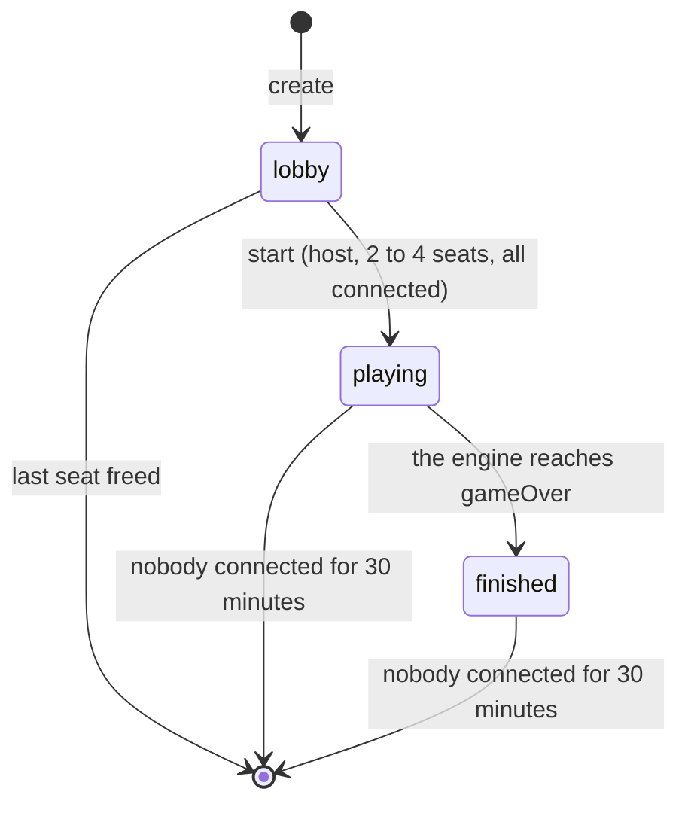

# Online protocol

Written in Session 5, stage 5a (2026-11-12). It replaces the sketch in `docs/architecture.md` §10. The message types are in `packages/server/src/protocol.ts`; the room and session core that implements this file is `packages/server/src/core.ts`. Decisions made here that no earlier document covered are also logged in `docs/rulebook-engine-notes.md`.

## 1. Principles

- **The server is authoritative.** It holds the only full `GameState`. A client sends an intent; the server checks it with the engine's `applyAction` and either applies it or rejects it.
- **Clients only ever see a `PlayerView`.** Every game message is built with `redactForClient`. The seed, the RNG state and the order of the draw piles never leave the server.
- **The seat decides who is acting.** The server sets an action's `player` from the connection's seat. Anything a client puts in that field is dropped.
- **Messages are plain JSON objects with a `type`.** The transport (WebSocket, stage 5b) carries one JSON object per frame, in order.
- **The core has no I/O.** `ServerCore` is told about messages, closed connections and the time, and returns what to send. See [section 9](#9-the-core-for-stage-5b).

## 2. Rooms and seats

- A room has a **code**: 4 letters from `BCDFGHJKMNPQRSTVWXZ` (no vowels, so no words; no `L`). Codes are matched in any case, ignoring spaces around them.
- A room has **2 to 4 seats** (`minPlayers` and `maxPlayers` in `content/rules.json`). Seat ids are `p1` to `p4` and are the engine's player ids. A player who joins takes the lowest free seat.
- Each seat has a **seat token**: a 128-bit random secret sent once, to its owner, in `welcome`. It proves who owns the seat when reconnecting. The client keeps it (for example in `localStorage`, with the room code).
- A connection holds at most one seat.
- A **name** is trimmed, inner whitespace is collapsed, and it must be 1 to 20 characters. Two players in a room cannot have the same name (ignoring case).
- The **host** is the player who created the room. Only the host can start the game. If the host's seat is freed in the lobby, the lowest remaining seat becomes host.

Room status:



Nobody can join a room once the game has started. There are no spectators yet.

## 3. Client to server

| Message  | Fields                            | Allowed when                 | Reply                                             |
| -------- | --------------------------------- | ---------------------------- | ------------------------------------------------- |
| `create` | `v`, `name`                       | The connection has no seat   | `welcome`                                         |
| `join`   | `v`, `code`, `name`               | No seat; the room is a lobby | `welcome`; `room` to the others                   |
| `rejoin` | `v`, `code`, `seatToken`          | No seat                      | `welcome`; `room` to the others                   |
| `start`  |                                   | Host, in the lobby           | `room`, then `update` with `seq` 0, to everyone   |
| `intent` | `clientActionId`, `seq`, `action` | Seated                       | `update` to everyone, or `rejected` to the sender |
| `sync`   |                                   | Seated                       | `snapshot`                                        |
| `leave`  |                                   | Seated                       | `left`; `room` to the others                      |

- `v` is the protocol version, currently `1`. The server refuses any other value with `unsupported-version`, so an old cached web client fails clearly instead of misbehaving.
- `action` is an engine `Action` without `player`: `{ "type": "roll" }`, `{ "type": "move", "to": 57 }`, `{ "type": "placeShip", "dock": "start-left" }`, `{ "type": "buyUpgrade", "upgrade": "speed" }`, `{ "type": "useHelicopter" }`, `{ "type": "endTurn" }`. Clients pick one from `getLegalActions(content, view, seat)`.
- `clientActionId` is any string of 1 to 64 characters chosen by the client. It comes back in `rejected` so the client can match the reply to what it sent.
- `seq` in an intent is the `seq` of the view the player was looking at. See [section 5](#5-sequence-numbers).
- The server validates every message's shape and rebuilds it field by field. Unknown fields are ignored. No string may be longer than 64 characters (names are checked separately).

## 4. Server to client

| Message    | Fields                                                  | Sent to              | When                                                                  |
| ---------- | ------------------------------------------------------- | -------------------- | --------------------------------------------------------------------- |
| `welcome`  | `v`, `seat`, `seatToken`, `contentHash`, `room`, `game` | One connection       | After `create`, `join` or `rejoin`                                    |
| `room`     | `room`                                                  | Everyone in the room | A seat is taken, freed, connected or disconnected; the status changes |
| `update`   | `seq`, `by`, `auto`, `events`, `view`                   | Everyone in the room | The game starts; an action is applied                                 |
| `snapshot` | `room`, `game`                                          | One connection       | Reply to `sync`                                                       |
| `rejected` | `clientActionId`, `seq`, `error { code, message }`      | The sender           | An intent was not applied                                             |
| `error`    | `code`, `message`                                       | The sender           | Any other message could not be acted on                               |
| `left`     |                                                         | The sender           | Reply to `leave`                                                      |

- `room` is a `RoomInfo`: `code`, `status` (`lobby`, `playing`, `finished`), `host`, `seats` (`seat`, `name`, `connected`, in seat order), `minPlayers`, `maxPlayers`, `rev`. It is always sent whole. `rev` goes up by one on every change, so a client keeps the one with the highest `rev`.
- `game` is `null` in the lobby, otherwise `{ seq, view }`.
- `view` is the receiver's own `PlayerView` (`view.viewer` is their seat). It is sent whole in every `update`; it is small.
- `events` are the engine's `GameEvent`s for that action, the same for everyone. They are for animation and the log. The view alone is enough to carry on.
- `by` is the seat that acted (`null` for the start of the game). `auto` is `true` when the server chose the action for an away player ([section 7](#7-disconnect-policy)).
- `contentHash` lets a client check, before the game starts, that the content it bundles matches the server's.
- When the game ends, the last `update` carries `view.result`, and a `room` message with status `finished` follows it.

### Error codes

`error.code`:

| Code                   | Meaning                                                           |
| ---------------------- | ----------------------------------------------------------------- |
| `bad-message`          | Not a valid message (wrong shape, unknown type, malformed action) |
| `unsupported-version`  | `v` is not the server's protocol version                          |
| `not-seated`           | The connection has no seat; `create`, `join` or `rejoin` first    |
| `already-seated`       | The connection already has a seat; `leave` first                  |
| `room-not-found`       | No room has that code                                             |
| `room-full`            | Every seat is taken                                               |
| `game-started`         | Joining or starting a room that is no longer a lobby              |
| `name-invalid`         | The name is empty or too long                                     |
| `name-taken`           | Someone in the room has that name                                 |
| `bad-token`            | The seat token does not belong to a seat in that room             |
| `not-host`             | Only the host can start the game                                  |
| `not-enough-players`   | Fewer than `minPlayers` seats are taken                           |
| `players-disconnected` | A seated player is disconnected, so the game cannot start         |
| `replaced`             | The seat was opened on a newer connection; this one is closed     |
| `server-busy`          | No free room code could be found                                  |

`rejected.error.code`: the engine's `game-over`, `unknown-player`, `not-your-turn`, `wrong-phase`, `illegal-action`, plus:

| Code      | Meaning                                              |
| --------- | ---------------------------------------------------- |
| `stale`   | The intent's `seq` is not the server's current `seq` |
| `no-game` | The game has not started                             |

## 5. Sequence numbers

`seq` is the engine's `actionCount`: the number of actions applied so far.

- The `update` for the start of the game has `seq` 0. The `update` for the Nth action has `seq` N. Updates in a room have no gaps and are never repeated.
- **Client rule for updates.** Apply an `update` if its `seq` is the client's `seq` plus one (or 0 with no game yet). Ignore one that is not newer. If there is a gap, send `sync` and use the `snapshot`. The transport is ordered, so a gap should only ever follow a reconnect, and `rejoin` already returns the current view.
- **Intents must name the current `seq`.** The server applies an intent only if its `seq` equals the server's; otherwise it replies `rejected` with `stale` and the current `seq`. This makes intents safe to repeat: at most one intent can be applied for each `seq`. Without it, a double-tapped `endTurn` could close the shop and then also skip the end-of-turn Helicopter choice, and an intent re-sent after a reconnect could be applied twice.
- After `stale`, the client should not retry. It already has, or is about to receive, the newer view; the player chooses again from that.
- The engine's legality check still applies after the `seq` check.

No event history is kept for clients. A client that missed updates gets the current view, not the events in between.

## 6. Reconnecting

1. The connection drops. The server marks the seat disconnected and sends `room` to the others. The seat and its token stay.
2. The client opens a new connection and sends `rejoin { v, code, seatToken }`.
3. The server replies `welcome` with the same seat and token, the room, and the current game snapshot. The others get `room`.
4. The client discards any intent it had not seen an answer to. If it had been applied, the snapshot already shows it.

- If the seat still has a live connection (a second tab, or a dead socket the server has not noticed), the **newest connection wins**. The old one is sent `error` with `replaced` and is closed.
- `rejoin` works in the lobby, during the game and after it has finished, for as long as the room and the seat exist.
- A wrong token gets `bad-token`. Tokens are compared only within the room named by `code`.

## 7. Disconnect policy

All times are settings (`CoreConfig`); the defaults are below.

### In the lobby

- A disconnected player's seat is kept for **2 minutes** (`lobbyGraceMs`), then freed. The token stops working.
- `leave` frees the seat at once.
- The game cannot start while a seated player is disconnected.
- A lobby with no seats is deleted.

### In a game

A seat is never freed during a game. The game is not paused for the other players.

- A disconnected player has **60 seconds** (`reconnectGraceMs`), counted from the disconnect, to come back. Nothing happens for them in that time. If it is their decision, the game waits.
- After the grace, the player is **away**. Whenever an away player has to decide, the server decides for them **2 seconds** (`autoActionDelayMs`) after the previous action, so the others can follow what happens.
- Reconnecting ends this immediately. A later disconnect starts a new grace period.
- `leave` during a game means away at once, with no grace. The seat is kept and the player can still `rejoin`.
- An automatic action is an ordinary action: it goes through `applyAction`, is added to the replay log, and is sent as an `update` with `auto: true`.

**What the server chooses for an away player** (`chooseAutoAction` in `autoplay.ts`). The aim is to keep the game moving while doing as little as possible on the player's behalf. It is deterministic, uses only public information and never spends the player's money.

| Phase       | Action                                                                                              |
| ----------- | --------------------------------------------------------------------------------------------------- |
| `placeShip` | The first free dock                                                                                 |
| `roll`      | `roll` (never the Helicopter)                                                                       |
| `move`      | The first legal destination that is not a risk tile; if every destination is a risk tile, the first |
| `dockShop`  | `endTurn` (never buys an upgrade)                                                                   |
| `turnEnd`   | `endTurn` (never the Helicopter)                                                                    |

"First" is the order of `getLegalActions`. A move may end on a dock, which sells the player's fish as usual.

### When nobody is connected

- The server plays for nobody. The game stands still.
- When someone reconnects, every other disconnected player's 60-second grace starts again from that moment (unless they had sent `leave`).
- A room nobody has been connected to for **30 minutes** (`roomIdleTtlMs`) is deleted, whatever its status.

### Not covered

There is no turn timer for a player who is connected but not acting. Playtests are run on a voice call; see [section 10](#10-open-items).

## 8. Example

Ann creates a room, Bob and Cy join, Ann starts, and the first player places a ship.

```text
Ann  → { "type": "create", "v": 1, "name": "Ann" }
Ann  ← { "type": "welcome", "v": 1, "seat": "p1", "seatToken": "9f…", "contentHash": "…",
         "room": { "code": "KTBM", "status": "lobby", "host": "p1", "rev": 0,
                   "seats": [{ "seat": "p1", "name": "Ann", "connected": true }],
                   "minPlayers": 2, "maxPlayers": 4 },
         "game": null }

Bob  → { "type": "join", "v": 1, "code": "ktbm", "name": "Bob" }
Bob  ← welcome (seat p2, room rev 1)
Ann  ← { "type": "room", "room": { …, "rev": 1 } }
Cy   → join … (seat p3, room rev 2)

Ann  → { "type": "start" }
all  ← { "type": "room", "room": { …, "status": "playing", "rev": 3 } }
all  ← { "type": "update", "seq": 0, "by": null, "auto": false,
         "events": [gameStarted, turnOrderDecided, …], "view": { …, "viewer": "p1" | "p2" | "p3" } }

Bob  → { "type": "intent", "clientActionId": "b-1", "seq": 0,
         "action": { "type": "placeShip", "dock": "start-left" } }
all  ← { "type": "update", "seq": 1, "by": "p2", "auto": false, "events": […], "view": … }

Cy   → { "type": "intent", "clientActionId": "c-1", "seq": 1, "action": { "type": "roll" } }
Cy   ← { "type": "rejected", "clientActionId": "c-1", "seq": 1,
         "error": { "code": "not-your-turn", "message": "…" } }
```

## 9. The core, for stage 5b

`ServerCore` (`packages/server/src/core.ts`) is everything above except the sockets.

```ts
const core = new ServerCore({ content, now: Date.now, ids: cryptoIds(), config });

core.handleMessage(connId, json); // → Outbound[]   a parsed JSON message arrived
core.disconnect(connId); // → Outbound[]   the connection closed
core.tick(); // → Outbound[]   do whatever is due now
core.nextDeadline(); // → number | null  when tick() next has work
```

- `Outbound` is `{ kind: "send", to, message }` or `{ kind: "close", to, reason }`. Carry them out in order.
- The transport gives each connection its own `connId`, does `JSON.parse` (send `bad-message` yourself, or pass a non-object, if parsing fails), and calls `disconnect` exactly once when a socket closes, including one the core asked it to close. `disconnect` for a connection the core no longer knows does nothing.
- Call `tick()` on a timer: once a second is enough, or schedule it from `nextDeadline()`.
- `loadContent(dir)` reads and compiles `content/*.json`. `cryptoIds()` makes real room codes, tokens and seeds.
- `core.replayLog(code)` returns the room's `ReplayLog`. It contains the seed, so it must not reach a client while the game is being played.
- Left to the transport: heartbeats (to notice dead sockets), a maximum message size, rate limits, and a cap on the number of rooms.

### The WebSocket transport (stage 5b)

`createGameServer` in `packages/server/src/transport.ts` wraps the core; `main.ts` serves it with `GET /health` on one port (`PORT`, default 8787). What a client can see of it (settings in `TransportConfig`, decisions in `docs/rulebook-engine-notes.md`):

| Situation                                       | What happens                                        |
| ----------------------------------------------- | --------------------------------------------------- |
| Text that is not JSON, or a binary frame        | `error` `bad-message`; the socket stays open        |
| A frame over 4 KiB                              | Closed with 1009                                    |
| More than 30 messages at once, or 10 a second   | Closed with 1008 `rate limit`                       |
| No pong to the previous ping (pings every 15 s) | Socket dropped (the client sees 1006)               |
| The core closes it (`replaced`)                 | `error` first, then closed with 4000 and the reason |
| 500 rooms exist                                 | `create` is answered `error` `server-busy`          |
| The server shuts down                           | Socket dropped                                      |

The web client can import the message types from `packages/server/src/protocol.ts`, which has no Node imports.

## 10. Open items

- No turn timer for connected players, no host "kick", no pause.
- No spectators (`redactForClient` already accepts `"spectator"`).
- No rematch in the same room (Milestone B3).
- Rooms live in memory: a server restart ends every game. The replay log would be enough to restore one.
- The replay log is not offered to clients after the game.
