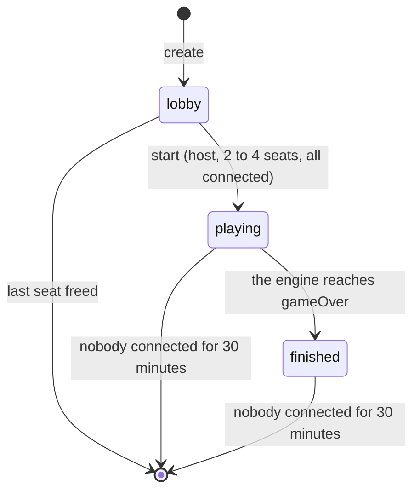

# Online protocol

Written in Session 5, stage 5a (2026-11-12). It replaces the sketch in `docs/architecture.md` §10. The message types are in `packages/server/src/protocol.ts`; the room and session core that implements this file is `packages/server/src/core.ts`. Decisions made here that no earlier document covered are also logged in `docs/rulebook-engine-notes.md`.

## 1. Principles

- **The server is authoritative.** It holds the only full `GameState`. A client sends an intent; the server checks it with the engine's `applyAction` and either applies it or rejects it.
- **Clients only ever see a `PlayerView`.** Every game message is built with `redactForClient`. The seed, the RNG state and the order of the draw piles never leave the server.
- **The seat decides who is acting.** The server sets an action's `player` from the connection's seat. Anything a client puts in that field is dropped.
- **Messages are plain JSON objects with a `type`.** The transport (WebSocket, stage 5b) carries one JSON object per frame, in order.
- **The core has no I/O.** `ServerCore` is told about messages, closed connections and the time, and returns what to send. See [section 9](#9-the-core-for-stage-5b).

## 2. Rooms and seats

- A room has a **code**: 4 letters from `BCDFGHJKMNPQRSTVWXZ` (no vowels, so no words; no `L`). Codes are matched in any case, ignoring spaces around them.
- A room has **2 to 4 seats** (`minPlayers` and `maxPlayers` in `content/rules.json`). Seat ids are `p1` to `p4` and are the engine's player ids. A player who joins takes the lowest free seat.
- Each seat has a **seat token**: a 128-bit random secret sent once, to its owner, in `welcome`. It proves who owns the seat when reconnecting. Where the web client keeps it (`apps/web/src/useGame.ts`, `savedSeats.ts`):
  - **`sessionStorage`** (per tab): room code, seat and token. A refresh rejoins from here by itself.
  - **`localStorage`** (shared by every tab of the browser): a list of saved seats (room code, seat, token, player name, when saved), one entry per room and seat, newest first, at most 10, dropped after 2 days. The start screen of a tab with no seat of its own _offers_ them ("Rejoin room KTBM as Ann"); nothing rejoins until the player clicks, so two tabs of one browser can still be two players. An entry is removed on `left`, on `bad-token` (that token) and on `room-not-found` (every seat of that room).
  - **Rejoin link**: the lobby and the table show the page address with `#rejoin=CODE.TOKEN`. The token is in the fragment, so it is never sent to a web server or logged. Opening the link offers the seat in the same way and rejoins on click; the fragment is then removed from the address bar. The link is the player's own seat and must not be shared.
  - After `replaced` (§6) a tab drops its `sessionStorage` seat and goes back to the start screen with a message, so neither a retry nor a refresh takes the seat back by itself.
- A connection holds at most one seat.
- A **name** is trimmed, inner whitespace is collapsed, and it must be 1 to 20 characters. Two players in a room cannot have the same name (ignoring case).
- The **host** is the player who created the room. Only the host can start the game. If the host's seat is freed in the lobby, the lowest remaining seat becomes host.

Room status:



Nobody can join a room once the game has started. There are no spectators yet.

## 3. Client to server

| Message  | Fields                            | Allowed when                 | Reply                                                                              |
| -------- | --------------------------------- | ---------------------------- | ---------------------------------------------------------------------------------- |
| `create` | `v`, `name`                       | The connection has no seat   | `welcome`                                                                          |
| `join`   | `v`, `code`, `name`               | No seat; the room is a lobby | `welcome`; `room` to the others                                                    |
| `rejoin` | `v`, `code`, `seatToken`          | No seat                      | `welcome`; `room` to the others                                                    |
| `start`  |                                   | Host, in the lobby           | `room`, then `update` with `seq` 0, to everyone                                    |
| `intent` | `clientActionId`, `seq`, `action` | Seated                       | `update` to everyone, or `rejected` to the sender                                  |
| `sync`   |                                   | Seated                       | `snapshot`                                                                         |
| `leave`  |                                   | Seated                       | `left`; `room` to the others                                                       |
| `kick`   | `seat`                            | Host, lobby or game          | Lobby: `room`; game: `update` and `room`; the removed player gets `error` `kicked` |

- `v` is the protocol version, currently `1`. The server refuses any other value with `unsupported-version`, so an old cached web client fails clearly instead of misbehaving.
- `action` is an engine `Action` without `player`: `{ "type": "roll" }`, `{ "type": "move", "to": 57 }`, `{ "type": "placeShip", "dock": "start-left" }`, `{ "type": "buyUpgrade", "upgrade": "speed" }`, `{ "type": "useHelicopter" }`, `{ "type": "endTurn" }`. Clients pick one from `getLegalActions(content, view, seat)`.
- `clientActionId` is any string of 1 to 64 characters chosen by the client. It comes back in `rejected` so the client can match the reply to what it sent.
- `seq` in an intent is the `seq` of the view the player was looking at. See [section 5](#5-sequence-numbers).
- The server validates every message's shape and rebuilds it field by field. Unknown fields are ignored. No string may be longer than 64 characters (names are checked separately).

## 4. Server to client

| Message    | Fields                                                  | Sent to              | When                                                                                |
| ---------- | ------------------------------------------------------- | -------------------- | ----------------------------------------------------------------------------------- |
| `welcome`  | `v`, `seat`, `seatToken`, `contentHash`, `room`, `game` | One connection       | After `create`, `join` or `rejoin`                                                  |
| `room`     | `room`                                                  | Everyone in the room | A seat is taken, freed, connected, disconnected or becomes away; the status changes |
| `update`   | `seq`, `by`, `auto`, `events`, `view`, `turnTimeLeftMs` | Everyone in the room | The game starts; an action is applied                                               |
| `snapshot` | `room`, `game`                                          | One connection       | Reply to `sync`                                                                     |
| `rejected` | `clientActionId`, `seq`, `error { code, message }`      | The sender           | An intent was not applied                                                           |
| `error`    | `code`, `message`                                       | The sender           | Any other message could not be acted on                                             |
| `left`     |                                                         | The sender           | Reply to `leave`                                                                    |

- `room` is a `RoomInfo`: `code`, `status` (`lobby`, `playing`, `finished`), `host`, `seats` (`seat`, `name`, `connected`, `away`, `removed`, `awayInMs`, in seat order), `minPlayers`, `maxPlayers`, `timers`, `rev`. It is always sent whole. `rev` goes up by one on every change, so a client keeps the one with the highest `rev`.
- `timers` is the room's time limits, fixed when the room is created: `turnTimeoutMs` (`null` if there is no turn timer), `reconnectGraceMs`, `reconnectBudgetMs` ([section 7](#7-disconnect-policy)).
- `awayInMs` is, in a game, for a disconnected player who is not yet away: how many milliseconds are left before they are away. Otherwise `null`.
- `game` is `null` in the lobby, otherwise `{ seq, view, turnTimeLeftMs }`.
- `turnTimeLeftMs` (in `game` and in `update`) is how many milliseconds the deciding player has left before the server plays for them. It is `null` when no turn timer runs: no timer is set, the deciding player is away (the server acts after the short delay instead), or the game is over.
- **Times are relative.** `awayInMs` and `turnTimeLeftMs` are counted when the message is sent. A client adds them to the time the message arrived on its own clock, so client and server clocks need not agree. They are not resent as time passes; a later message carries fresh values.
- `view` is the receiver's own `PlayerView` (`view.viewer` is their seat). It is sent whole in every `update`; it is small.
- `events` are the engine's `GameEvent`s for that action, the same for everyone. They are for animation and the log. The view alone is enough to carry on.
- `by` is the seat that acted (`null` for the start of the game; the host for a kick). `auto` is `true` when the server missed a turn, for an away player or because the turn timer ran out ([section 7](#7-disconnect-policy)).
- `contentHash` lets a client check, before the game starts, that the content it bundles matches the server's.
- When the game ends, the last `update` carries `view.result`, and a `room` message with status `finished` follows it.
- **Golden Hook Awards** (B1b; rulebook "End of the game"): which awards are in play and the players' stats are never in a view, an event or any other message before the game ends. The last `update` reveals them: one `awardGiven` event per award (in draw order, just before `gameEnded`: `award`, `amount`, `value`, `qualified`, `winners`), and `view.result` carries `awards` (the same list), `stats` (every player's counted stats) and, for each score, `awards` (money won), with `total = cash - fine tokens × $100 + awards`. No new message type; the protocol version stays 1.

### Error codes

`error.code`:

| Code                   | Meaning                                                             |
| ---------------------- | ------------------------------------------------------------------- |
| `bad-message`          | Not a valid message (wrong shape, unknown type, malformed action)   |
| `unsupported-version`  | `v` is not the server's protocol version                            |
| `not-seated`           | The connection has no seat; `create`, `join` or `rejoin` first      |
| `already-seated`       | The connection already has a seat; `leave` first                    |
| `room-not-found`       | No room has that code                                               |
| `room-full`            | Every seat is taken                                                 |
| `game-started`         | Joining or starting a room that is no longer a lobby                |
| `name-invalid`         | The name is empty or too long                                       |
| `name-taken`           | Someone in the room has that name                                   |
| `bad-token`            | The seat token does not belong to a seat in that room               |
| `not-host`             | Only the host can start the game                                    |
| `not-enough-players`   | Fewer than `minPlayers` seats are taken                             |
| `players-disconnected` | A seated player is disconnected, so the game cannot start           |
| `replaced`             | The seat was opened on a newer connection; this one is closed       |
| `server-busy`          | No free room code could be found                                    |
| `kicked`               | This player was removed from the room; the token no longer works    |
| `cannot-kick`          | That seat cannot be removed (yourself, unknown, removed, game over) |
| `server-error`         | The server hit an error handling this message (a bug); try again    |
| `room-closed`          | The room hit a server error and was closed; the seat is gone        |

A bug in the server never stops other rooms (review P2-4). If handling a message throws, nothing half-built is sent and only the sender gets `server-error`; the room is kept. If a room throws while the server runs its timers (turn timer, grace, lobby seats), it would throw again on every tick, so it is **closed**: each connected player gets `room-closed`, their connection stays open with no seat, the room and its tokens are gone, and the error is logged with the room code. Other rooms are served on the same tick.

`rejected.error.code`: the engine's `game-over`, `unknown-player`, `not-your-turn`, `wrong-phase`, `illegal-action`, plus:

| Code      | Meaning                                              |
| --------- | ---------------------------------------------------- |
| `stale`   | The intent's `seq` is not the server's current `seq` |
| `no-game` | The game has not started                             |

## 5. Sequence numbers

`seq` is the engine's `actionCount`: the number of actions applied so far.

- The `update` for the start of the game has `seq` 0. The `update` for the Nth action has `seq` N. Updates in a room have no gaps and are never repeated.
- **Client rule for updates.** Apply an `update` if its `seq` is the client's `seq` plus one (or 0 with no game yet). Ignore one that is not newer. If there is a gap, send `sync` and use the `snapshot`. The transport is ordered, so a gap should only ever follow a reconnect, and `rejoin` already returns the current view.
- **Intents must name the current `seq`.** The server applies an intent only if its `seq` equals the server's; otherwise it replies `rejected` with `stale` and the current `seq`. This makes intents safe to repeat: at most one intent can be applied for each `seq`. Without it, a double-tapped `endTurn` could close the shop and then also skip the end-of-turn Helicopter choice, and an intent re-sent after a reconnect could be applied twice.
- After `stale`, the client should not retry. It already has, or is about to receive, the newer view; the player chooses again from that.
- The engine's legality check still applies after the `seq` check.

No event history is kept for clients. A client that missed updates gets the current view, not the events in between.

## 6. Reconnecting

1. The connection drops. The server marks the seat disconnected and sends `room` to the others. The seat and its token stay.
2. The client opens a new connection and sends `rejoin { v, code, seatToken }`.
3. The server replies `welcome` with the same seat and token, the room, and the current game snapshot. The others get `room`.
4. The client discards any intent it had not seen an answer to. If it had been applied, the snapshot already shows it.

- If the seat still has a live connection (a second tab, or a dead socket the server has not noticed), the **newest connection wins**. The old one is sent `error` with `replaced` and is closed.
- `rejoin` works in the lobby, during the game and after it has finished, for as long as the room and the seat exist.
- A wrong token gets `bad-token`. Tokens are compared only within the room named by `code`.

## 7. Disconnect policy

All times are settings (`CoreConfig`); the defaults are below.

### In the lobby

- A disconnected player's seat is kept for **2 minutes** (`lobbyGraceMs`), then freed. The token stops working.
- `leave` frees the seat at once.
- The game cannot start while a seated player is disconnected.
- A lobby with no seats is deleted.

### In a game

A seat is never freed during a game. The game is not paused for the other players.

**Turn timer and missed turns** (review P1-2; rules decided with the designer, 2026-11-13; rulebook "Online play").

- A player has **90 seconds** (`turnTimeoutMs`) for a whole turn: rolling, moving and shopping. It counts from the start of the turn (each setup placement counts as one), or from the moment a room nobody was connected to is rejoined. Decisions inside the turn do not restart it.
- When it runs out, the server applies the engine's system action `missTurn` for them (`reason: "timeout"`). Before the move (placing at setup or late entry, rolling, moving) the turn is missed (`turnMissed`): nothing more happens (no move, no card, no purchase, no Helicopter) and the turn passes; a ship to be placed goes on the first dock offered. After the move (the dock shop, the end-of-turn Helicopter choice, the dock after a Sinking Boat) the turn just ends (`turnTimedOut`, review P2-3): what was done stands, nothing is bought or used, a Sinking Boat ship goes on the first dock offered with no shop; it is not a missed turn and counts for neither removal nor the awards. The same split applies to an away player's turn. The update has `auto: true`. The player is not marked away.
- It runs whether the player is connected or not: a disconnect never extends a turn.
- Clients see it as `turnTimeLeftMs` ([section 4](#4-server-to-client)). There is no turn timer in the lobby. `turnTimeoutMs: null` switches it off.
- **The server never plays for a player.** It only misses their turns.
- **3 timed-out turns in a row** (`missedTurnsBeforeRemoval` in `content/rules.json`) and the engine removes the player (`playerRemoved`, reason `missed-turns`). Any action of the player's own resets the count. The server sends `missTurn` with `reason: "timeout"` when the turn timer ran out and `reason: "away"` when it misses an away player's turn; only `timeout` counts (`turnMissed.counted`). An away miss neither counts nor resets the run (review P1-1).

**Removing a player** (host kick).

- The host sends `kick { seat }`. In the lobby the seat is freed at once (as after `leave`). In a game the server applies the engine's system action `removePlayer` (`playerRemoved`, reason `kicked`); the update's `by` is the host.
- A removed player's ship leaves the board; they get no more turns, cannot win, and are shown in the results. Their seat stays in `RoomInfo` with `removed: true`; their token stops working (`rejoin` answers `kicked`).
- Their connection is sent `error` `kicked` (after the update that removed them) and then has no seat; the socket stays open.
- If the host is removed (after missed turns), the lowest remaining seat becomes host.
- With one player left the game ends at once and they win (`result.reason` is `last-player`).
- Only the host can kick (`not-host`); not themselves, an unknown or already removed seat, or after the game (`cannot-kick`).

**Reconnect grace and its budget.**

- A disconnected player has up to **60 seconds** (`reconnectGraceMs`), counted from the disconnect, to come back. During that time they are not away; if it is their turn, the turn timer still runs.
- Each player has a **budget** of **2 minutes** (`reconnectBudgetMs`) of grace for the whole game. The time they spend disconnected and not away is taken from it (at most one grace per disconnect; time while nobody in the room is connected does not count). A disconnect with less than 60 seconds of budget left gets only what is left; with nothing left the player is away at once. The budget is full for everyone when the game starts.
- Clients see what is left of a disconnected player's grace as `awayInMs`.
- After the grace, the player is **away**: their seat's `away` becomes `true` and everyone gets a `room` message. Whenever it is an away player's turn, the server misses it **2 seconds** (`autoActionDelayMs`) after the previous action, so the others can follow what happens. These misses do not count towards removal, so the server never removes an away player; the host can (`kick`).
- **Never sooner than 10 seconds after the disconnect** (`disconnectFloorMs`, review P2-2): an away player's turn is missed at the later of the 2-second delay and 10 seconds after they disconnected, so a blip with no budget left (away at once) does not lose the turn if they are back within 10 seconds. Not after `leave` (a deliberate exit gets only the 2-second delay). The floor never holds back the turn timer: a turn that runs its 90 seconds is missed on time, connected or not.
- Reconnecting ends this immediately (`away` goes back to `false`). A later disconnect starts a new grace period, from what is left of the budget.
- `leave` during a game means away at once, with no grace and no budget used. The seat is kept and the player can still `rejoin` (until they are removed).
- A missed turn or a removal is an ordinary action: it goes through `applyAction`, is added to the replay log, and is sent as an `update`. Clients can never send these actions (`parse.ts` refuses them).

### When nobody is connected

- The server misses nobody's turn. The game stands still.
- When someone reconnects, every other disconnected player's grace starts again from that moment (unless they had sent `leave`), capped by what is left of their budget; a player with no budget left stays away. The turn timer also counts from that moment.
- A room nobody has been connected to for **30 minutes** (`roomIdleTtlMs`) is deleted, whatever its status.

### After a server restart

With rooms saved ([section 9](#saving-rooms-review-p2-5)), a restarted server brings every room back with **nobody connected**, as if everyone had just dropped at the moment it started: the rules for an empty room above apply. So nothing happens until someone rejoins; then the turn timer counts a whole turn from then and the others' graces start, from what is left of their budgets (a player who had sent `leave` is away at once). Lobby seats get a fresh 2-minute lobby grace; a room nobody comes back to is deleted after 30 minutes. Players rejoin as after any disconnect (same seat token, `rejoin`, `welcome` with the current view). Nothing new is sent to clients: a restored room's `rev` is one above the saved one.

### Not covered

The host cannot pause the game; see [section 10](#10-open-items).

## 8. Example

Ann creates a room, Bob and Cy join, Ann starts, and the first player places a ship.

```text
Ann  → { "type": "create", "v": 1, "name": "Ann" }
Ann  ← { "type": "welcome", "v": 1, "seat": "p1", "seatToken": "9f…", "contentHash": "…",
         "room": { "code": "KTBM", "status": "lobby", "host": "p1", "rev": 0,
                   "seats": [{ "seat": "p1", "name": "Ann", "connected": true, "away": false,
                               "removed": false, "awayInMs": null }],
                   "minPlayers": 2, "maxPlayers": 4,
                   "timers": { "turnTimeoutMs": 90000, "reconnectGraceMs": 60000,
                               "reconnectBudgetMs": 120000 } },
         "game": null }

Bob  → { "type": "join", "v": 1, "code": "ktbm", "name": "Bob" }
Bob  ← welcome (seat p2, room rev 1)
Ann  ← { "type": "room", "room": { …, "rev": 1 } }
Cy   → join … (seat p3, room rev 2)

Ann  → { "type": "start" }
all  ← { "type": "room", "room": { …, "status": "playing", "rev": 3 } }
all  ← { "type": "update", "seq": 0, "by": null, "auto": false,
         "events": [gameStarted, turnOrderDecided, …], "view": { …, "viewer": "p1" | "p2" | "p3" },
         "turnTimeLeftMs": 90000 }

Bob  → { "type": "intent", "clientActionId": "b-1", "seq": 0,
         "action": { "type": "placeShip", "dock": "start-left" } }
all  ← { "type": "update", "seq": 1, "by": "p2", "auto": false, "events": […], "view": … }

Cy   → { "type": "intent", "clientActionId": "c-1", "seq": 1, "action": { "type": "roll" } }
Cy   ← { "type": "rejected", "clientActionId": "c-1", "seq": 1,
         "error": { "code": "not-your-turn", "message": "…" } }
```

## 9. The core, for stage 5b

`ServerCore` (`packages/server/src/core.ts`) is everything above except the sockets.

```ts
const core = new ServerCore({ content, now: Date.now, ids: cryptoIds(), config });

core.handleMessage(connId, json); // → Outbound[]   a parsed JSON message arrived
core.disconnect(connId); // → Outbound[]   the connection closed
core.tick(); // → Outbound[]   do whatever is due now
core.nextDeadline(); // → number | null  when tick() next has work
```

- `Outbound` is `{ kind: "send", to, message }` or `{ kind: "close", to, reason }`. Carry them out in order.
- The transport gives each connection its own `connId`, does `JSON.parse` (send `bad-message` yourself, or pass a non-object, if parsing fails), and calls `disconnect` exactly once when a socket closes, including one the core asked it to close. `disconnect` for a connection the core no longer knows does nothing.
- Call `tick()` on a timer: once a second is enough, or schedule it from `nextDeadline()`.
- `loadContent(dir)` reads and compiles `content/*.json`. `cryptoIds()` makes real room codes, tokens and seeds.
- `core.replayLog(code)` returns the room's `ReplayLog`. It contains the seed, so it must not reach a client while the game is being played.
- Left to the transport: heartbeats (to notice dead sockets), a maximum message size, rate limits, and a cap on the number of rooms.

### The WebSocket transport (stage 5b)

`createGameServer` in `packages/server/src/transport.ts` wraps the core; `main.ts` serves it with `GET /health` on one port (`PORT`, default 8787). What a client can see of it (settings in `TransportConfig`, decisions in `docs/rulebook-engine-notes.md`):

| Situation                                       | What happens                                        |
| ----------------------------------------------- | --------------------------------------------------- |
| Text that is not JSON, or a binary frame        | `error` `bad-message`; the socket stays open        |
| A frame over 4 KiB                              | Closed with 1009                                    |
| More than 30 messages at once, or 10 a second   | Closed with 1008 `rate limit`                       |
| No pong to the previous ping (pings every 15 s) | Socket dropped (the client sees 1006)               |
| The core closes it (`replaced`)                 | `error` first, then closed with 4000 and the reason |
| 500 rooms exist                                 | `create` is answered `error` `server-busy`          |
| The server shuts down                           | Socket dropped                                      |

### Saving rooms (review P2-5)

The core stays free of I/O: it hands out snapshots and takes them back; the transport saves them.

```ts
core.takeChanges(); // → { save: RoomSnapshot[], remove: string[] }  rooms changed or gone since the last call
core.snapshotRoom(code); // → RoomSnapshot | null
core.restoreRoom(json); // → { ok: true, code } | { ok: false, reason }   never throws
```

- `RoomSnapshot` (`src/snapshot.ts`): code, status, host, `rev`, timers, seats (id, name, token, `left`, `away`, `removed`, reconnect budget left) and, once started, the game's `ReplayLog` plus its current `GameState`. No connection ids and no clock times. It holds seat tokens and the seed: **server-side only**.
- `restoreRoom` checks the shape, refuses a code already in use or a log made with other content (content hash), replays the log and refuses it unless the result equals the saved state (and the status, players and removals agree).
- `createGameServer({ store })` takes a `RoomStore` (`load`, `save`, `remove`, `discard`). On start it restores every saved room; an unreadable or refused entry is logged with the reason and moved aside (`discard`), and never stops the server. After every core call it saves what changed and deletes what is gone; a failed write is logged and the game goes on in memory.
- `fileRoomStore(dir)` (`src/roomStore.ts`): one file `<CODE>.json` per room, created `0600` in a `0700` folder, written to a temporary file and renamed (never half a file); an unchanged room is not written again; a bad file becomes `<CODE>.json.bad`. `main.ts` uses it when `ROOMS_DIR` is set.

The web client can import the message types from `packages/server/src/protocol.ts`, which has no Node imports.

## 10. Open items

- No pause. A bot taking a removed player's place (the designer's option, once bots exist, B6).
- No spectators (`redactForClient` already accepts `"spectator"`).
- No rematch in the same room (Milestone B3).
- Rooms are saved only when the server is given a `RoomStore` (`ROOMS_DIR`); without one, a restart ends every game. A store for deployment (a database, if the host has no lasting disk or runs more than one server) is for B5.
- The replay log is not offered to clients after the game.
